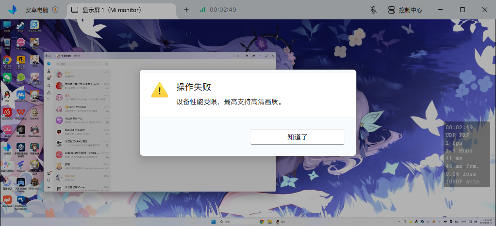

# uu_remote_hook

**解除 UU远程主控端的普通画质档位限制，让「超清」「原画」可以正常选择。**

[](#运行环境)
[](#快速开始)
[](LICENSE)

部分设备在开始远控后，选择更高画质会出现「设备性能受限，最高支持高清画质。」：



本项目通过 Frida 在运行中的 `GameViewer.exe` 内临时调整画质能力查询结果。**按实现特征自动定位目标函数**，不使用固定 RVA 或版本号白名单；只提升已成功协商的普通 SDR、4:2:0 格式的画质上限。安装文件保持原样，停止脚本即可卸载 Hook。

```text
+-----------------------------+
| 控制中心 > 画质             |
|   高清                      |
|   超清  [可选择]            |
|   原画  [可选择]            |
+-----------------------------+
```

这是独立的非官方项目。适用范围和验证记录见下文。

## 运行环境

- Windows x64。
- Python 3.10 或以上，使用 64 位解释器。
- 已安装 UU远程 Windows 客户端，当前电脑作为主控端。
- PowerShell 5.1 或以上。

## 快速开始

获取项目后，在项目目录打开 PowerShell：

```powershell
# Create a virtual environment and install dependencies.
.\Setup.ps1

# Start the controller in the background.
.\Start-QualityHook.ps1
```

看到 `The quality hook is ready.` 后，在 UU远程连接设备，打开「控制中心 → 画质」，选择「超清」或「原画」。若客户端还未运行，脚本显示等待状态；随后打开 UU远程即可自动加载。

停止并撤销：

```powershell
.\Stop-QualityHook.ps1
```

后台控制器运行期间，会在客户端重启后重新识别并加载 Hook。电脑重启后需再次执行启动脚本。停止 Hook 会恢复后续能力查询的原逻辑，已选画质不会被脚本主动切回高清。

如果 PowerShell 阻止执行本地脚本，可仅对本次命令使用执行策略参数：

```powershell
powershell -NoProfile -ExecutionPolicy Bypass -File .\Setup.ps1
powershell -NoProfile -ExecutionPolicy Bypass -File .\Start-QualityHook.ps1
```

已有 Python 未加入 PATH 时，可以显式指定：

```powershell
.\Setup.ps1 -PythonPath 'C:\Python312\python.exe'
```

## 先检查兼容性

检查运行中的客户端，只读取文件，不注入进程：

```powershell
.\.venv\Scripts\python.exe .\quality_hook.py --check
```

检查另一份**已解出的主客户端 EXE**：

```powershell
.\.venv\Scripts\python.exe .\quality_hook.py --check --exe 'D:\Extracted\bin\GameViewer.exe'
```

`--exe` 需要主客户端程序，不能直接传下载得到的安装包。静态检查不会执行目标文件。成功时输出 `compatible: true`、版本、SHA256 和发现的 RVA；失败时返回非零退出码及原因。

## 通用定位如何工作

1. 解析当前 EXE 的 PE 结构，确认 Windows x64 ABI 和画质、编解码器枚举。
2. 扫描可执行节，以能力协商失败结果作为候选锚点。
3. 用 Capstone 校验候选函数的返回结构、输出参数、质量比较及被调用函数。被调用函数必须按 28 字节遍历能力记录，并正确处理 H.264/H.265 两类记录。
4. 只接受唯一通过校验的目标。注入前再核对内存中的函数入口与刚分析的文件是否一致。
5. 原查询成功、格式为 SDR 4:2:0 且画质上限小于 4 时，将画质字段提升到 4，保留编解码器、尺寸和其他字段。

兼容单位是**同一种实现及结构布局**。地址、模块基址、版本号、部分寄存器分配和日志代码变化不会要求填写新地址。若后续客户端更换 ABI、返回结构或核心协商逻辑，定位器会拒绝注入，需要调整结构校验规则。

详细字段、定位边界及开发方法见 [实现说明](docs/implementation.md)。

## 验证记录

验证日期：2026-10-12。

| 客户端版本 | 静态自动定位 | 实际注入 | 超清 / 原画实际切换 |
| --- | --- | --- | --- |
| 4.42.0.2770（本机已安装） | 通过，唯一目标 | 通过 | 用户确认两档均正常，画面正常；日志记录请求接受 |
| 4.27.3.8503（安装包解出） | 通过，唯一目标 | 未运行 | 未测试 |

两个版本使用同一套定位规则，目标 RVA 分别为 `0x1694F60` 和 `0x9FEA00`。这些地址仅作为验证记录，程序中没有按版本选择它们。

自动测试覆盖寄存器变化、镜像基址变化、多候选、错误被调用函数，以及枚举、结构字段、步长和架构变化。测试样本由项目自行构造，不包含客户端文件，也不注入任何进程。

## 状态与日志

```powershell
Get-Content .\.runtime\status.json
Get-Content .\.runtime\events.jsonl -Tail 20
```

状态 `ready` 表示已加载；`waiting` 表示等待客户端；`unsupported` 表示尚未成功加载，具体原因在事件日志中。日志时间采用带时区的 UTC ISO 8601 格式。

| 事件 | 含义 |
| --- | --- |
| `hook_ready` | 已校验目标并加载 Hook |
| `quality_cap_raised` | 一次查询中的画质上限已提升 |
| `quality_request_checked` | 可选诊断：客户端是否接受画质请求 |
| `attach_failed` | 识别、内存核对或注入失败 |
| `hook_removed` | 已撤销 Hook |

部分兼容实现无法定位可选的画质请求诊断函数。日志中的 `presenter_diagnostics: false` 只影响该项诊断，能力上限 Hook 仍可加载。

## 常见问题

**升级客户端后要改地址吗？**

先运行 `--check`。同实现版本会自动重新定位；若校验失败，把检查结果用于兼容性报告。

**能解除 HDR 或真彩限制吗？**

本项目处理普通画质档位。HDR、真彩、分辨率及底层编解码器能力保持原有逻辑。

**能选择高画质，但画面卡顿或异常怎么办？**

先降低画质或帧率；需要撤销时执行停止脚本。Hook 提升的是客户端查询结果中的上限，实际画面表现仍取决于两端编解码器和网络。

**注入提示访问被拒绝怎么办？**

检查 UU远程和控制器的运行权限。若客户端以管理员权限运行，控制器也需要相应权限。详细错误记录在 `.runtime/events.jsonl`。

**只想前台运行或指定一个客户端进程？**

```powershell
.\.venv\Scripts\python.exe .\quality_hook.py
.\.venv\Scripts\python.exe .\quality_hook.py --pid 1234
```

前台运行时按 `Ctrl+C` 可卸载。每个状态目录只允许一个控制器，重复启动不会叠加 Hook。

## 项目结构

```text
uu_remote_hook/
  locator.py                 Static implementation discovery
  quality_hook.py            CLI and process controller
  quality_hook.js            Reversible Frida hooks
  Setup.ps1                  Environment setup
  Start-QualityHook.ps1       Background launcher
  Stop-QualityHook.ps1        Graceful unload
  requirements.txt           Pinned dependencies
  tests/                     Synthetic PE regression tests
  docs/                      Implementation notes and screenshot
  .github/workflows/         Windows checks
```

`workspace/`、`.venv/`、`.runtime/` 等本地目录已由 `.gitignore` 排除。仓库不分发 UU远程安装包、客户端二进制或第三方解包工具。

## 开发与许可证

```powershell
.\.venv\Scripts\python.exe -m unittest discover -s tests -v
node --check .\quality_hook.js
git diff --check
```

参与开发请阅读 [贡献说明](CONTRIBUTING.md)。项目代码以 [MIT](LICENSE) 许可证发布。
